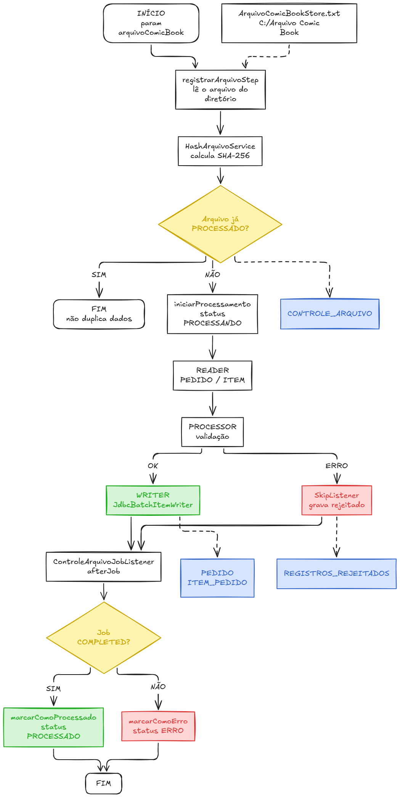
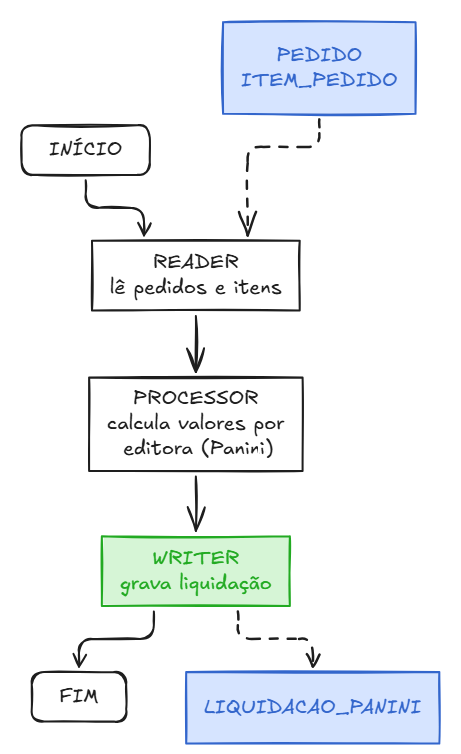

# ETL Comic Book Store

Pipeline ETL em Spring Batch que lê um arquivo de pedidos de uma loja de quadrinhos, valida os registros, grava os válidos no Oracle e calcula o repasse das vendas da editora Panini.

## Índice

- [Fluxo macro](#fluxo-macro)
- [Fluxograma](#fluxograma)
- [Tecnologias](#tecnologias)
- [Como executar](#como-executar)
- [Arquivo de teste](#arquivo-de-teste)
- [Formato do arquivo de entrada](#formato-do-arquivo-de-entrada)
- [Reprocessamento](#reprocessamento)

## Fluxo macro

O job `jobImportacao` roda três steps em sequência:

1. **Registro do arquivo** (`registrarArquivoStep`): calcula o SHA-256 do arquivo e o registra em `CONTROLE_ARQUIVO` com status `PROCESSANDO`. Se o mesmo conteúdo já foi processado, ou está em processamento, o job não executa.
2. **Importação** (`stepComicBooks`): lê o arquivo em blocos de 1000 linhas, valida cada registro e grava os aprovados em `PEDIDO` e `ITEM_PEDIDO`. Registros reprovados não interrompem o job: vão para `REGISTROS_REJEITADOS` com a linha original, o motivo e a etapa do erro.
3. **Liquidação** (`vendasQuadrinhasLiquidadasStep`): lê do banco os itens vendidos da Panini ainda não liquidados e grava em `LIQUIDACAO_PANINI` a divisão de 20% para a loja e 80% para a editora.

Ao final, `CONTROLE_ARQUIVO` passa para `PROCESSADO` ou `ERRO`.

Regras de validação que rejeitam um registro:

- pedido duplicado;
- frete acima de 20,00;
- status `NAO_ENTREGUE`, `CANCELADA` ou `COMPRA_RECUSADO`;
- pagamento via `PIX`;
- e-mail ausente;
- item duplicado, com preço zerado ou cujo pedido foi rejeitado.

## Fluxograma

### Importação



### Liquidação



## Tecnologias

| Tecnologia | Uso |
|---|---|
| Java 21 | Linguagem |
| Spring Boot 4.1 / Spring Batch 6 | Aplicação e processamento em lote |
| Flyway | Versionamento do esquema (`src/main/resources/db/migration`) |
| Oracle Database Free | Banco de dados |
| Maven (wrapper incluso) | Build |
| Docker Compose | Execução do Oracle e da aplicação |

## Como executar

Pré-requisito: Docker e Docker Compose. Não é necessário ter Java, Maven ou Oracle instalados.

1. Clone o repositório e entre na pasta do módulo:

```bash
cd ETL-COMICBOOK-STORE
```

2. Crie o `.env` a partir do modelo:

```bash
cp .env.example .env
```

3. Edite o `.env`:

```
ORACLE_PASSWORD=sua_senha_admin
DB_USER=comic
DB_PASSWORD=sua_senha_app
ARQUIVOS_DIR=C:/Arquivo Comic Book
```

`ARQUIVOS_DIR` é a pasta do seu computador onde ficará o arquivo de entrada.

4. Coloque o arquivo `ArquivoComicBookStore.txt` dentro de `ARQUIVOS_DIR` (veja [Arquivo de teste](#arquivo-de-teste)).

5. Suba o Oracle e a aplicação:

```bash
docker compose up --build
```

A aplicação aguarda o Oracle ficar saudável, executa o job e encerra. Para derrubar os containers:

```bash
docker compose down
```

O banco fica exposto em `localhost:1522` (serviço `FREEPDB1`), com o usuário e a senha definidos em `DB_USER` e `DB_PASSWORD`.

### Sem Docker

Requer JDK 21 e um Oracle acessível em `localhost:1522/FREEPDB1`.

```powershell
$env:DB_USER = "seu_usuario"
$env:DB_PASSWORD = "sua_senha"
./mvnw spring-boot:run
```

Nesse modo o arquivo é lido de `C:/Arquivo Comic Book` (propriedade `importacao.diretorio`). Para processar outro arquivo:

```powershell
./mvnw spring-boot:run -Dspring-boot.run.arguments=--arquivoComicBook=outro_arquivo.txt
```

## Arquivo de teste

Baixe o arquivo de exemplo: [ArquivoComicBookStore.txt](ETL-COMICBOOK-STORE/exemplo/ArquivoComicBookStore.txt) (na página do arquivo no GitHub, use o botão de download).

Para usar:

1. Salve o arquivo com o nome `ArquivoComicBookStore.txt`.
2. Coloque-o na pasta definida em `ARQUIVOS_DIR` no `.env` (ou em `C:/Arquivo Comic Book` se rodar sem Docker).
3. Execute o projeto.

Resultado esperado com esse arquivo:

| Tabela | Conteúdo |
|---|---|
| `PEDIDO` | 4 pedidos (1001 a 1004) |
| `ITEM_PEDIDO` | 6 itens |
| `REGISTROS_REJEITADOS` | 7 registros: pedido 1005 (PIX), 1006 (não entregue), 1007 (frete acima do teto), 1001 repetido, e os itens órfãos desses três pedidos |
| `LIQUIDACAO_PANINI` | 5 itens da Panini liquidados |

Para repetir a execução com o mesmo arquivo, veja [Reprocessamento](#reprocessamento).

## Formato do arquivo de entrada

Uma linha por registro, campos separados por `;`, começando pelo tipo do registro. Os itens devem vir depois do pedido a que pertencem.

```
PEDIDO;<idPedido>;<dataHora>;<idCliente>;<nome>;<email>;<status>;<formaPagamento>;<valorTotal>;<frete>;<desconto>
ITEM;<idPedido>;<seq>;<sku>;<titulo>;<editora>;<qtd>;<precoUnitario>;<valorItem>
```

`dataHora` em `yyyy-MM-dd HH:mm:ss` e decimais com ponto (`29.90`).

## Reprocessamento

- Arquivo com o mesmo conteúdo de um já `PROCESSADO` não é processado novamente.
- Arquivo cuja última execução terminou em `ERRO` pode ser reprocessado.
- Arquivo `PROCESSANDO` bloqueia novas execuções até a anterior terminar.

Para reprocessar o arquivo de teste do zero, apague o volume do banco: `docker compose down -v`.

